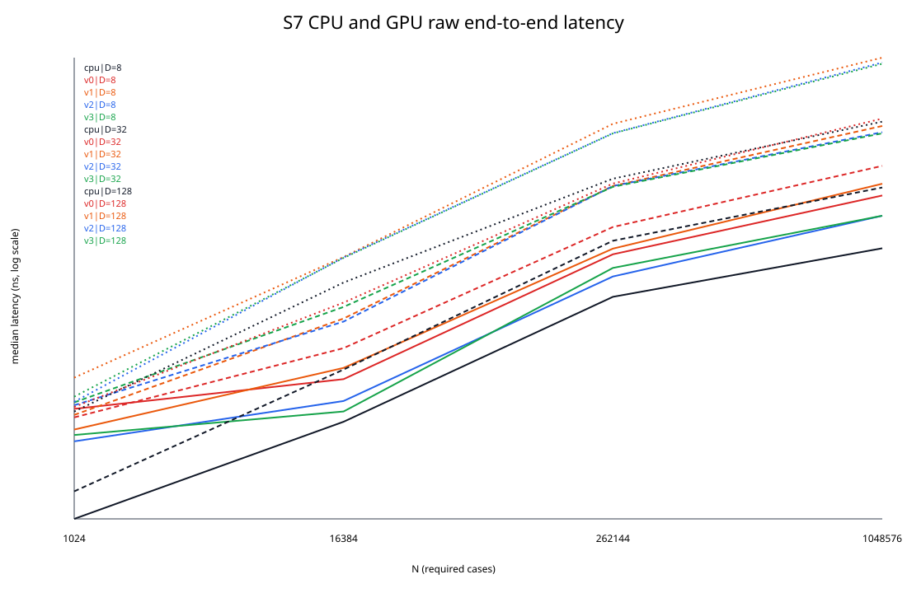
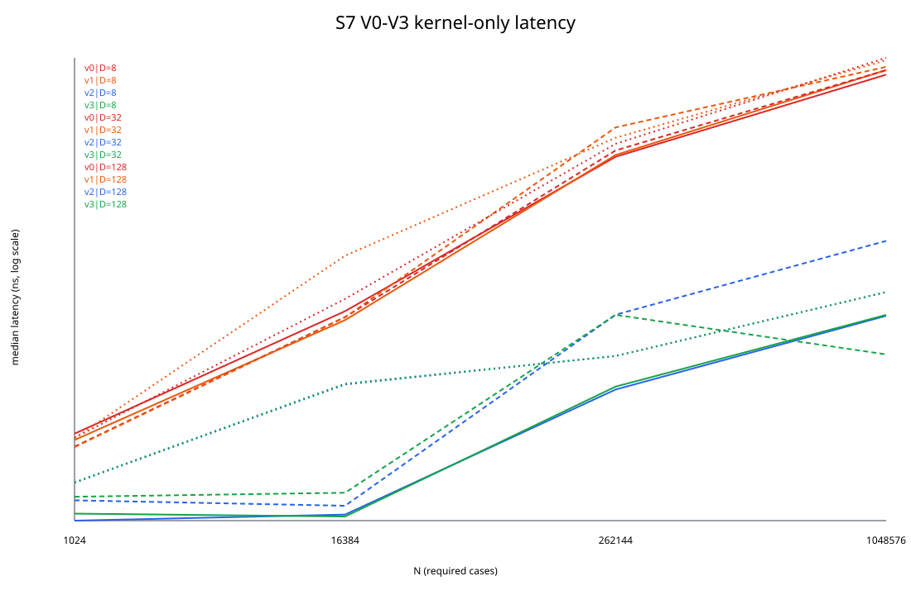
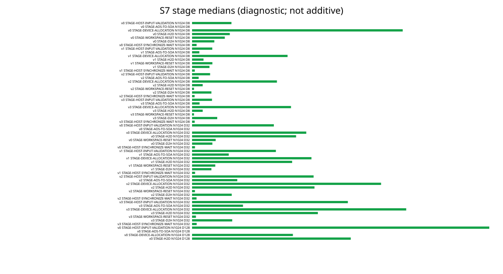
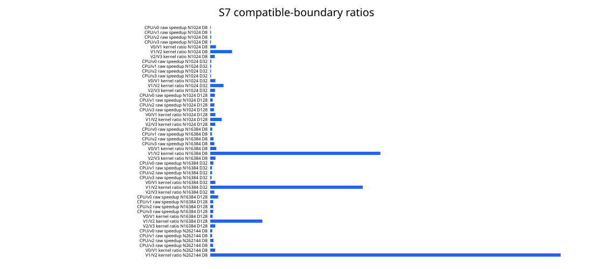

# Final Experiment Report: GPU-Accelerated Exact Nearest Neighbor Search Using CUDA

## Abstract

This report evaluates exhaustive exact single-query nearest-neighbor search on a Float32 CPU baseline and four CUDA implementations, V0–V3. All production variants compute squared Euclidean distance (L2²) using the approved arithmetic graph and select the smallest index when computed distances are equal. The accepted experiment covers 12 `(N,D)` cases, uses independent tuning and final seeds, executes 10 warm-ups and retains 100 measurements per reported configuration, and separates kernel-only from raw end-to-end timing. Correctness after configuration freeze passed for all required cases. Performance acceptance was `accepted`: H3 was supported in all 12 cases, while H1, H2, and H4 were rejected. In particular, V2 substantially improved kernel latency over V1, but V3 was not universally faster than V2 and raw GPU end-to-end latency did not beat the CPU baseline in any H1 case.

## 1. Identity, objectives, and predeclared question

| Field | Observed value |
|---|---|
| Experiment ID | `S7-ACCEPT-20261103-01` |
| Title | S7 accepted single-query CPU/CUDA V0–V3 performance evaluation |
| Capture time | `2026-11-03T17:11:06.5361275+07:00`, SE Asia Standard Time |
| Operator | `Zajow` |
| Repository revision | `e6bf8f39d7807cc0eecf68956e92a599332ef4ff` |
| Recorded working tree | `clean` |
| Branch observed at submission packaging | `feat/s7-performance-evaluation` |
| Approved design | `S6ApprovedImplementationDesign-v1.0` |
| Numerical policy | `S6-CONSOLIDATED-NUMERICAL-POLICY-v1.0`, SHA-256 `503aa6b2c97567d814a9316fb0f2f9890d5472aea2bcf1f928ac505c29d1aa39` |
| Scope | Correctness-gated performance; primary single query |
| Production variants | CPU Float32, CUDA V0, V1, V2, V3 |
| Batch/V4 | Not evaluated; not required for core V0–V3 completion |

Objectives were to verify the common exact-search/numerical contract, qualify and freeze V2/V3 block sizes, preserve comparable single-query timing distributions, and evaluate four predeclared universal hypotheses without an invented absolute performance target.

The ratio definition was `median(reference) / median(candidate)`. A case was supported when the conservative ratio interval was wholly above 1, rejected when wholly below 1, and inconclusive when it included 1. A universal hypothesis required all 12 cases to be supported; one rejected case rejected the universal claim.

## 2. Problem and numerical correctness contract

For dataset candidates `x_i` and query `q`, the search evaluates every candidate using:

`d_i = Σ_j (x_i[j] - q[j])²`

and returns the lexicographic minimum `(d_i, i)`. The production distance and result are Float32; the Float64 lane is an independent reference and diagnostic path, not a production replacement. Inputs with NaN, infinity, `N=0`, or `D=0` are rejected; signed zero is accepted; core squared distances must remain finite in Float32. Equal computed distances select the smallest index.

The accepted numerical policy separately validates returned argmin, Float32 distance error, every-candidate bounds, contender/ambiguity classification, arithmetic graph/environment, and ordered verdict. An index match alone is not sufficient acceptance.

## 3. Implementations under comparison

| Variant | Data layout and reduction design |
|---|---|
| CPU Float32 | Sequential candidate traversal using the approved ascending per-dimension graph and lexicographic argmin |
| CUDA V0 | AoS; one thread completes one candidate distance; one-thread device kernel performs final reduction |
| CUDA V1 | SoA for candidate-coalesced access; same per-candidate graph and serial reducer as V0 |
| CUDA V2 | SoA; shared-memory lexicographic block reduction; pair-only kernels reduce block outputs |
| CUDA V3 | SoA; warp shuffles and warp-leader shared-memory reduction; pair-only kernels complete the hierarchy |

No CUDA variant may reorder contributions within one candidate distance. V3 uses the approved full-warp/common-mask/safe-source participation rules. Consequently, the experiment isolates implementation changes while preserving the production search contract.

## 4. Environment and build

| Field | Captured value |
|---|---|
| Operating system | Microsoft Windows 11 Home Single Language, version/build `10.0.26300` |
| CPU | 11th Gen Intel Core i7-11370H @ 3.30 GHz; 8 logical processors |
| Host memory | `51215941632` bytes |
| GPU | NVIDIA GeForce RTX 3060 Laptop GPU, 6144 MiB, compute capability 8.6 |
| GPU UUID | `GPU-6119f54a-ff96-d0a6-df23-0b48a8bd991f` |
| Driver | `617.14`; CUDA driver API value `13040` |
| CUDA Toolkit/runtime | Toolkit value `13030` (13.3); runtime value `13040`; CUDA architecture `86` |
| Host compiler | MSVC version family `19.51` |
| Build | Release; `CUDA_ARCH=86`; `/fp:strict`; fast math disabled |
| GPU mode/link | WDDM; observed PCIe generation 4, width x4 at preflight |
| Power/temperature preflight | 85.00 W recorded power limit; 77 C |
| Streams/allocation | Default CUDA stream; synchronous one-shot API; pageable `std::vector` host allocation |
| Timers | `steady_clock` for host/raw timing; CUDA events for `BND-KERNEL` and GPU stages |

Telemetry reported no unauthorized GPU confounders, zero discarded samples, no telemetry error, and `Not Active` for hardware thermal slowdown in all captured telemetry records. No approved numeric temperature/clock/power rejection threshold existed, so these observations are not converted into an invented acceptance threshold.

## 5. Workload, tuning, and measurement methodology

The required matrix is `N ∈ {1024,16384,262144,1048576}` crossed with `D ∈ {8,32,128}`, yielding 12 cases. Workloads were generated by `S7-DETERMINISTIC-SYNTHETIC-v1`.

| Item | Value |
|---|---|
| Tuning seed | `11820040416388919760` |
| Final seed | `589684135938649225` |
| Seed separation | Verified; tuning and final seeds differ |
| Block candidates | `{128,256,512}` |
| Selection metric | `BND-KERNEL` median; exact ties choose the smaller block |
| Sampling | 10 warm-ups, then 100 retained measurements per configuration |
| Percentiles | `linear_n_minus_1` p5/median/p95 |
| Median uncertainty | Deterministic percentile bootstrap, 2,000 resamples, 95% interval |
| Run order | N ascending, D ascending; tune V2 then V3; final CPU/V0/V1/V2/V3 |

Every block candidate first passed the applicable qualification matrix. After independent tuning, the mapping was frozen, the full V2/V3 correctness matrix was rerun, and only then were final samples collected. Final measurements were not used for retrospective tuning.

The frozen target-specific selections were:

| N | D | V2 block | V3 block |
|---:|---:|---:|---:|
| 1024 | 8 | 128 | 128 |
| 1024 | 32 | 128 | 128 |
| 1024 | 128 | 256 | 128 |
| 16384 | 8 | 128 | 256 |
| 16384 | 32 | 256 | 256 |
| 16384 | 128 | 128 | 512 |
| 262144 | 8 | 512 | 512 |
| 262144 | 32 | 128 | 512 |
| 262144 | 128 | 512 | 128 |
| 1048576 | 8 | 256 | 128 |
| 1048576 | 32 | 128 | 128 |
| 1048576 | 128 | 256 | 128 |

These are observations for the tested target, not universal optimization requirements.

### Timing boundaries

- **CPU-E2E-RAW:** CPU Float32 one-shot call from entry before validation through synchronous host result return.
- **BND-E2E-RAW (primary GPU result):** validation, per-call preprocessing/allocation, V1–V3 AoS-to-SoA conversion, H2D, complete production kernels, D2H, synchronization, cleanup, and host result return. Dataset generation and reporting are excluded.
- **BND-KERNEL:** complete production kernel sequence using device-resident input/output/workspace, timed with CUDA events. Allocation, conversion, validation, H2D/D2H, reference/oracle work, and reporting are excluded.

Kernel-only and raw end-to-end results answer different questions and are never substituted for one another.

### Executed orchestration

The top-level accepted command was:

```powershell
& 'scripts/run-s7-benchmarks.ps1' -BuildDirectory 'build-s7-accept-20261103-01-sm86' -OutputDirectory 'build-s7-accept-20261103-01-sm86/s7-accept-20261103-01-retry1' -ExperimentConfig 'benchmarks/config/s7-accept-20261103-01.json' -ExpectedRevision 'e6bf8f39d7807cc0eecf68956e92a599332ef4ff' -EnvironmentApproval 'D:\ku\s7-local-config\s7-environment-approval.local.json'
```

The runner-recorded CTest, candidate-qualification, tuning, post-freeze correctness, final measurement, and analysis subcommands are retained verbatim in [`commands.jsonl`](evidence/environment-capture/commands.jsonl). The direct benchmark invocations are also retained in [`tuning/commands.txt`](evidence/tuning/commands.txt) and [`final/commands.txt`](evidence/final/commands.txt).

## 6. Correctness and acceptance evidence

The frozen correctness gate reports `passed-clean-candidate` for the same revision, clean tree, experiment configuration hash, and block mapping used by final measurement.

| Evidence | Result |
|---|---|
| V2 frozen required matrix | 12/12 accepted-unambiguous; failed 0; blocked 0 |
| V3 frozen required matrix | 12/12 accepted-unambiguous; failed 0; blocked 0 |
| Independent Float32 and Float64 comparisons | Passed in every V2/V3 matrix case |
| UD-001 distance containment and UD-002 contender evidence | Passed in every V2/V3 matrix case |
| Candidate retention, graph/environment, and binary/runtime correlation | Passed in every V2/V3 matrix case |
| Common CPU/V0/V1/V2/V3 comparison coverage | Passed through the frozen matrices |
| AC-012 correctness-before-performance | Passed |
| AC-013 benchmark protocol | Passed: 444 final configurations and 44,400 retained final samples |
| AC-014 environment/revision reproducibility | Passed |
| AC-015 benchmark policy | Passed |
| Final performance acceptance | `accepted` |

The raw final file contains exactly 44,400 completed, single-query, final-seed rows: 444 distinct summarized configurations with 100 retained samples each. Tuning is separate: 57,600 raw rows and 576 summaries. No tuning sample contributes to a final-reporting distribution.

## 7. Performance results

All latency tables below use milliseconds. Source data is stored in integer nanoseconds; displayed values are converted by division by 1,000,000. Complete p5, p95, and bootstrap intervals for every summarized row remain in [`summary.csv`](evidence/final/summary.csv) and [`summary.json`](evidence/final/summary.json).

### 7.1 Raw end-to-end median latency (ms)

| N | D | CPU raw | V0 raw | V1 raw | V2 raw | V3 raw |
|---:|---:|---:|---:|---:|---:|---:|
| 1024 | 8 | 0.095100 | 1.050450 | 0.668650 | 0.516900 | 0.593650 |
| 1024 | 32 | 0.173500 | 0.871800 | 0.920400 | 1.136450 | 1.209750 |
| 1024 | 128 | 0.990300 | 1.095950 | 2.075200 | 1.225400 | 1.370250 |
| 16384 | 8 | 0.792800 | 2.009350 | 2.568550 | 1.246900 | 0.992100 |
| 16384 | 32 | 2.477150 | 3.954100 | 7.546450 | 7.061700 | 9.721600 |
| 16384 | 128 | 16.558100 | 10.685400 | 28.923200 | 28.668300 | 28.355200 |
| 262144 | 8 | 12.124800 | 30.674000 | 34.721200 | 18.899400 | 22.784200 |
| 262144 | 32 | 41.228400 | 55.657900 | 136.340000 | 136.030000 | 133.832000 |
| 262144 | 128 | 159.760000 | 143.685000 | 529.759000 | 431.947000 | 429.601000 |
| 1048576 | 8 | 34.987200 | 110.780000 | 143.149000 | 71.225400 | 71.237600 |
| 1048576 | 32 | 131.836000 | 211.370000 | 505.374000 | 441.129000 | 430.270000 |
| 1048576 | 128 | 555.461000 | 593.497000 | 2245.640000 | 2019.330000 | 1966.090000 |



### 7.2 Kernel-only median latency (ms)

| N | D | V0 | V1 | V2 | V3 |
|---:|---:|---:|---:|---:|---:|
| 1024 | 8 | 0.127904 | 0.114112 | 0.026624 | 0.030208 |
| 1024 | 32 | 0.101264 | 0.100336 | 0.038400 | 0.040960 |
| 1024 | 128 | 0.118784 | 0.117760 | 0.052736 | 0.053248 |
| 16384 | 8 | 1.165820 | 0.992736 | 0.029696 | 0.028672 |
| 16384 | 32 | 1.049600 | 1.043460 | 0.034816 | 0.044032 |
| 16384 | 128 | 1.455100 | 3.172350 | 0.310272 | 0.315392 |
| 262144 | 8 | 18.907100 | 19.534300 | 0.283648 | 0.299008 |
| 262144 | 32 | 21.199400 | 32.117800 | 1.094140 | 1.090560 |
| 262144 | 128 | 23.908400 | 26.629100 | 0.518656 | 0.519680 |
| 1048576 | 8 | 83.241000 | 90.365400 | 1.072130 | 1.090560 |
| 1048576 | 32 | 90.278400 | 95.797200 | 4.142080 | 0.534528 |
| 1048576 | 128 | 112.690000 | 107.865000 | 1.644540 | 1.645570 |



### 7.3 Distribution example with p5, p95, and median interval

The largest case, `N=1,048,576, D=128`, illustrates why timing boundaries must remain separate.

| Variant/boundary | Median ms | p5 ms | p95 ms | Median 95% CI ms |
|---|---:|---:|---:|---:|
| CPU / CPU-E2E-RAW | 555.461000 | 482.415000 | 935.462000 | 536.514000–605.362000 |
| V0 / BND-E2E-RAW | 593.497000 | 491.089000 | 933.681000 | 577.937000–617.729000 |
| V1 / BND-E2E-RAW | 2245.640000 | 1751.390000 | 3066.890000 | 2161.710000–2383.540000 |
| V2 / BND-E2E-RAW | 2019.330000 | 1617.090000 | 2893.100000 | 1831.790000–2166.800000 |
| V3 / BND-E2E-RAW | 1966.090000 | 1616.780000 | 2877.770000 | 1815.350000–2033.420000 |
| V0 / BND-KERNEL | 112.690000 | 97.389200 | 137.074000 | 108.611000–114.528000 |
| V1 / BND-KERNEL | 107.865000 | 94.609400 | 119.977000 | 105.030000–109.925000 |
| V2 / BND-KERNEL | 1.644540 | 1.624060 | 1.652740 | 1.642500–1.645570 |
| V3 / BND-KERNEL | 1.645570 | 1.626110 | 1.947700 | 1.638910–1.646590 |



## 8. Hypothesis decisions



| Hypothesis | Universal outcome | Case classification | Evidence-bounded interpretation |
|---|---|---|---|
| H1: V3 raw E2E < CPU raw E2E in every case | **Rejected** | 12 rejected | CPU/V3 ratio was below 1 in every case; range `0.143418–0.799113×` |
| H2: V1 kernel < V0 kernel in every case | **Rejected** | 3 supported, 3 inconclusive, 6 rejected | Coalescing plus the retained serial reducer was not a universal kernel improvement |
| H3: V2 kernel < V1 kernel in every case | **Supported** | 12 supported | V1/V2 kernel speedup range `2.233010–84.286041×` |
| H4: V3 kernel < V2 kernel in every case | **Rejected** | 4 rejected, 8 inconclusive | Warp reduction did not universally improve on V2; no case was classified supported |

The complete per-case ratios and confidence intervals are in [`hypothesis-outcomes.json`](evidence/final/hypothesis-outcomes.json). Selected full decision tables follow so the universal outcomes are auditable from this report.

### H1: CPU/V3 raw end-to-end ratio

| N | D | Ratio | 95% interval | Case outcome |
|---:|---:|---:|---:|---|
| 1024 | 8 | 0.160195 | 0.155135–0.163281 | rejected |
| 1024 | 32 | 0.143418 | 0.131059–0.148662 | rejected |
| 1024 | 128 | 0.722715 | 0.667172–0.804418 | rejected |
| 16384 | 8 | 0.799113 | 0.754415–0.827708 | rejected |
| 16384 | 32 | 0.254809 | 0.224022–0.287935 | rejected |
| 16384 | 128 | 0.583952 | 0.524930–0.647162 | rejected |
| 262144 | 8 | 0.532157 | 0.450418–0.595374 | rejected |
| 262144 | 32 | 0.308060 | 0.273687–0.348677 | rejected |
| 262144 | 128 | 0.371880 | 0.347950–0.419210 | rejected |
| 1048576 | 8 | 0.491133 | 0.456966–0.515878 | rejected |
| 1048576 | 32 | 0.306402 | 0.289969–0.324464 | rejected |
| 1048576 | 128 | 0.282520 | 0.263847–0.333469 | rejected |

### H2: V0/V1 kernel ratio

| N | D | Ratio | 95% interval | Case outcome |
|---:|---:|---:|---:|---|
| 1024 | 8 | 1.120864 | 1.088496–1.159191 | supported |
| 1024 | 32 | 1.009249 | 1.000000–1.020619 | inconclusive |
| 1024 | 128 | 1.008696 | 1.000404–1.026316 | supported |
| 16384 | 8 | 1.174355 | 1.159239–1.187500 | supported |
| 16384 | 32 | 1.005888 | 0.998809–1.024777 | inconclusive |
| 16384 | 128 | 0.458683 | 0.443795–0.462287 | rejected |
| 262144 | 8 | 0.967892 | 0.963344–0.971139 | rejected |
| 262144 | 32 | 0.660051 | 0.651442–0.662787 | rejected |
| 262144 | 128 | 0.897827 | 0.763309–0.964825 | rejected |
| 1048576 | 8 | 0.921159 | 0.919962–0.925879 | rejected |
| 1048576 | 32 | 0.942390 | 0.914939–0.945474 | rejected |
| 1048576 | 128 | 1.044733 | 0.988045–1.090438 | inconclusive |

### H3: V1/V2 kernel ratio

| N | D | Ratio | 95% interval | Case outcome |
|---:|---:|---:|---:|---|
| 1024 | 8 | 4.286058 | 4.089699–4.346154 | supported |
| 1024 | 32 | 2.612917 | 2.487179–2.648649 | supported |
| 1024 | 128 | 2.233010 | 2.192308–2.272978 | supported |
| 16384 | 8 | 33.429957 | 32.000000–34.746094 | supported |
| 16384 | 32 | 29.970588 | 28.422535–31.000000 | supported |
| 16384 | 128 | 10.224422 | 10.073529–10.486755 | supported |
| 262144 | 8 | 68.868231 | 68.245518–113.319527 | supported |
| 262144 | 32 | 29.354235 | 13.981041–29.630640 | supported |
| 262144 | 128 | 51.342546 | 6.017370–60.806775 | supported |
| 1048576 | 8 | 84.286041 | 84.011447–84.534925 | supported |
| 1048576 | 32 | 23.127812 | 23.068345–183.552941 | supported |
| 1048576 | 128 | 65.589662 | 63.825763–66.925811 | supported |

### H4: V2/V3 kernel ratio

| N | D | Ratio | 95% interval | Case outcome |
|---:|---:|---:|---:|---|
| 1024 | 8 | 0.881356 | 0.840404–0.934054 | rejected |
| 1024 | 32 | 0.937500 | 0.860465–1.026316 | inconclusive |
| 1024 | 128 | 0.990385 | 0.962264–1.019608 | inconclusive |
| 16384 | 8 | 1.035714 | 1.000000–1.111111 | inconclusive |
| 16384 | 32 | 0.790698 | 0.750000–0.845238 | rejected |
| 16384 | 128 | 0.983766 | 0.972625–1.000000 | inconclusive |
| 262144 | 8 | 0.948630 | 0.576792–0.963731 | rejected |
| 262144 | 32 | 1.003286 | 0.477344–2.112088 | inconclusive |
| 262144 | 128 | 0.998030 | 0.124350–8.011928 | inconclusive |
| 1048576 | 8 | 0.983099 | 0.979381–0.987288 | rejected |
| 1048576 | 32 | 7.749042 | 0.125926–7.832262 | inconclusive |
| 1048576 | 128 | 0.999378 | 0.997512–1.004061 | inconclusive |

## 9. Interpretation

V2 is the only optimization step supported as a universal kernel-latency improvement under the predeclared criterion. Its hierarchical block/grid reduction removes the serial-reducer bottleneck retained by V0/V1. H2 shows that changing AoS to SoA while retaining serial reduction did not provide a consistent improvement. H4 shows that the additional V3 warp hierarchy did not consistently improve on V2: several comparisons were close or unstable and four cases significantly favored V2.

H1 demonstrates the distinction between kernel and application-visible timing. Despite fast V2/V3 kernels, raw one-shot GPU calls include allocation, layout conversion, transfers, synchronization, and cleanup. Under this public single-query scenario, V3 was slower than CPU Float32 in all 12 cases. The evidence therefore does not support a claim that GPU execution, V3, or the numerically most optimized kernel is universally fastest end to end.

## 10. Limitations and threats to validity

- Results apply to one RTX 3060 Laptop GPU, WDDM, CUDA 13.3-era toolchain, Windows environment, and the recorded power/thermal state. Block winners and performance are not universal constants.
- Only deterministic synthetic, primary single-query workloads were evaluated. Batch queries, prepared-query reuse, device-resident public scenarios, V4, and other data distributions were not evaluated.
- Ratio intervals conservatively combine separate bootstrap median intervals; they are not paired-sample causal intervals.
- WDDM and a display-capable laptop environment may increase raw timing variability. No unapproved sample deletion or numeric environment threshold was applied.
- The compact packet omits bulky raw samples and candidate binaries. Full independent audit requires the preserved external archive.
- `final/tuning-freeze.json` incorrectly records `tuning_median_ns=0` in all 24 mapping entries even though tuning summaries contain nonzero medians. The CSV mapping used by execution is preserved and correct; the JSON must not be used as a median source.
- `final/manifest.json` says `performance_acceptance=pending-complete-evidence` because it precedes final analysis. The later `final/acceptance.json` is the acceptance authority and says `accepted`.

## 11. Reproducibility and evidence

| Artifact | Reference | Integrity |
|---|---|---|
| Source revision | `e6bf8f39d7807cc0eecf68956e92a599332ef4ff` | Recorded clean in run metadata and acceptance |
| Experiment configuration | [`experiment-config.json`](evidence/final/experiment-config.json) | SHA-256 `54f09b93155e069324830edea3814776e23f9971de5d3c04725601dd53b72bda` |
| Environment/run metadata | [`environment-capture/`](evidence/environment-capture/) | Hashes recorded by final/tuning integrity manifests |
| Correctness gate/matrices | [`correctness-after-freeze/`](evidence/correctness-after-freeze/) | Gate `passed-clean-candidate`; full payload in archive |
| Final summary/comparisons | [`evidence/final/`](evidence/final/) | Final integrity status `passed`; recalculated hashes matched 32/32 |
| Tuning summary/freeze | [`evidence/tuning/`](evidence/tuning/) | Tuning integrity status `passed`; recalculated hashes matched 30/30 |
| Compact packet | [`PACKET_MANIFEST.sha256`](evidence/PACKET_MANIFEST.sha256) | 48 source-derived file hashes |
| Full evidence archive | `D:\ku\s7-evidence-archive\S7-ACCEPT-20261103-01-e6bf8f39-evidence.zip` | SHA-256 `be6f5d89a9115a961b5eedd2016e59a136b0d2a8ce14ab0941e8b02a990f4677`; 348,864,826 bytes; 257/257 verified |

Exact executed stage commands are preserved in [`commands.jsonl`](evidence/environment-capture/commands.jsonl), with final and tuning invocations in their respective `commands.txt` files. See the [evidence index](EVIDENCE_INDEX.md) for the complete compact/full mapping and intentionally external artifacts.

## 12. Outcome and conclusion

| Item | Final status |
|---|---|
| Correctness matrix | Accepted; 24/24 frozen V2/V3 case entries accepted-unambiguous |
| H1 | Rejected, 12/12 cases rejected |
| H2 | Rejected: 3 supported, 3 inconclusive, 6 rejected |
| H3 | Supported, 12/12 cases supported |
| H4 | Rejected: 4 rejected, 8 inconclusive |
| Performance acceptance | `accepted` |
| Failed/blocked acceptance checks | None reported by final acceptance |
| Retrospective tuning | No |

The project demonstrates contract-preserving CUDA exact nearest-neighbor implementations and a reproducible correctness-first evaluation. V2 delivered the robust kernel improvement; V3 did not provide a universal incremental kernel benefit, and neither V3 nor GPU execution should be described as universally fastest for the raw single-query API. The accepted outcome includes rejected hypotheses because the experiment completed with the required evidence rather than because every optimization claim succeeded.

The remaining submission action is operational: the Owner should create a second independent backup of the archive, review this documentation and compact packet, and perform the permitted Git commit/PR workflow.
